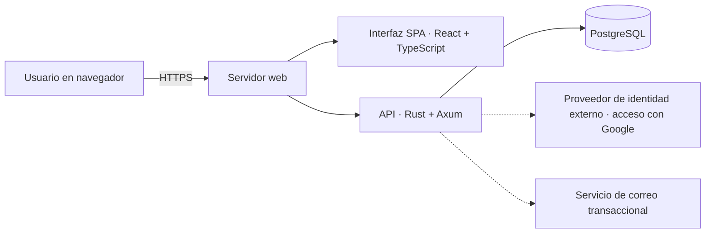

# GMAO — Arquitectura tecnológica (visión pública)

Sistema: GMAO — Gestión de Mantenimiento Institucional · 2026

---

## 1. Visión general

GMAO es una aplicación web de tres capas: una interfaz SPA, un API propio y una base de datos relacional como única fuente de verdad. Todo el código de negocio es propio; no usa CMS ni frameworks de servidor pesados.

Los servicios externos (identidad y correo) son opcionales: el sistema funciona de forma autónoma con autenticación propia.

## 2. Pila tecnológica

| Capa | Tecnología | Función |
| --- | --- | --- |
| Interfaz | React 19 + TypeScript | SPA con un panel por rol |
| Empaquetado | Vite | Desarrollo con recarga y build estático de producción |
| API | Rust (Axum + Tokio) | API HTTP, lógica de negocio y máquina de estados |
| Acceso a datos | SQLx | Consultas verificadas en tiempo de compilación, migraciones versionadas |
| Base de datos | PostgreSQL | Modelo relacional completo con bitácoras de auditoría |
| Identidad | Autenticación propia + acceso con Google | Contraseña con Argon2, MFA TOTP, sesiones con expiración |
| Correo | Servicio transaccional externo | Verificación de cuenta y recuperación de contraseña |
| Infraestructura | Docker Compose | Orquestación de los servicios de la solución |
| Pruebas | Suites end-to-end en Python + Playwright | Flujos completos por rol |

## 3. Decisiones de diseño

- **Rust en el backend**: seguridad de memoria, tipado fuerte y verificación de las consultas SQL en tiempo de compilación. Los errores de esquema se detectan al compilar, no en producción.
- **Un panel por rol**: cada perfil (solicitante, técnico, coordinador, dirección, administración) ve únicamente su flujo de trabajo, lo que simplifica la capacitación de usuarios no técnicos.
- **Máquina de estados central**: el ciclo de vida de una orden de trabajo se valida en el servidor; una transición ilegal se rechaza y cada transición válida queda en bitácora.
- **Motor preventivo automático**: el cronograma de mantenimiento preventivo genera las órdenes por sí solo cuando vencen, sin intervención manual.
- **Base de datos como única fuente de verdad**: roles y permisos se validan contra la base en cada petición, no solo contra el token de sesión.
- **Despliegue reproducible**: toda la solución se levanta con contenedores, con migraciones aplicadas automáticamente al arrancar.

## 4. Calidad y pruebas

- Suites end-to-end que recorren los flujos completos de cada rol: reportar, clasificar, asignar, ejecutar, aprobar y calificar.
- Pruebas específicas de inventario, insumos, indicadores y administración.
- Observabilidad con logs estructurados y sondas de salud para la operación.
