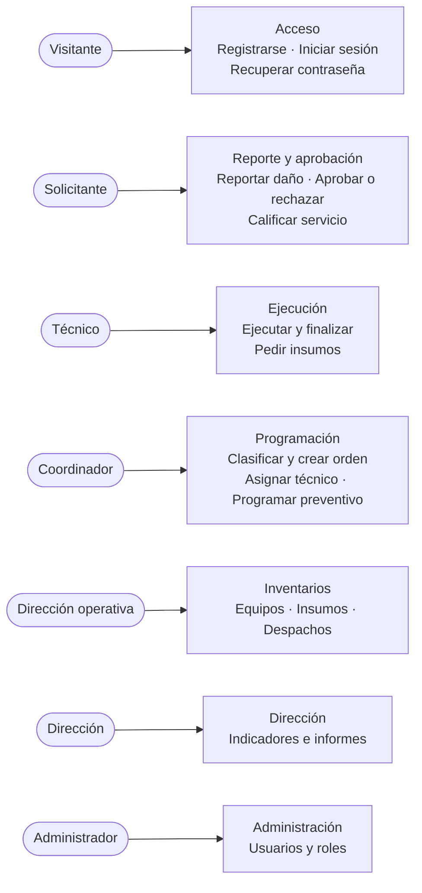

# GMAO — Casos de uso (visión pública)

Sistema: GMAO — Gestión de Mantenimiento Institucional · 2026

---

## 1. Actores

| Actor | Descripción |
| --- | --- |
| Visitante | Persona sin cuenta que accede a la pantalla de ingreso |
| Solicitante | Miembro de la comunidad que reporta daños y califica el servicio |
| Técnico | Ejecuta las órdenes de trabajo; puede pertenecer a un proveedor externo |
| Coordinador | Clasifica, asigna y programa el mantenimiento correctivo y preventivo |
| Dirección | Consulta indicadores e informes ejecutivos |
| Dirección operativa | Seguimiento, inventario de equipos e insumos y despachos |
| Administrador | Administra las cuentas y los roles |
| Sistema | Procesos automáticos: motor preventivo, correos y validaciones |

## 2. Flujo general

## 3. Ciclo de vida de una orden de trabajo

1. Un **solicitante** reporta un daño con fotos y ubicación.
2. El **coordinador** revisa la solicitud, la clasifica y crea la orden de trabajo.
3. El coordinador **asigna un técnico** (propio o de un proveedor externo).
4. El **técnico** ejecuta el trabajo, registra evidencias del antes y el después y, si lo necesita, solicita insumos al almacén.
5. El trabajo terminado pasa a **aprobación del solicitante**, quien lo acepta o lo devuelve.
6. Aprobado el trabajo, el solicitante **califica el servicio** y la orden se cierra.
7. La **dirección** ve el resultado reflejado en los indicadores.

En paralelo, el **motor preventivo** genera órdenes automáticamente según el cronograma de cada equipo, que siguen el mismo ciclo de ejecución y cierre.
