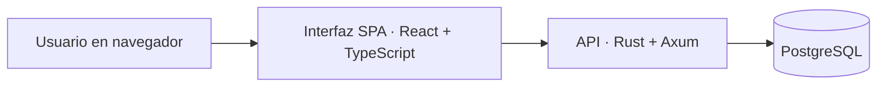

# GMAO — Gestión de Mantenimiento Institucional

Aplicación web para administrar el ciclo completo de mantenimiento de una institución: solicitudes de la comunidad, órdenes de trabajo correctivas, cronograma preventivo, inventario de equipos e insumos, evidencias fotográficas e indicadores de dirección.

Proyecto desarrollado a la medida para una institución de educación superior en Colombia, entregado y aceptado en 2026. Este repositorio es la ficha pública del proyecto: documenta su alcance, arquitectura y funcionalidades. El código fuente es privado y pertenece a un desarrollo bajo reserva de derechos (ver [LICENSE.md](LICENSE.md)).

**Página demostrativa**: https://helynecheverry.github.io/gmao/

---

## Qué resuelve

Las áreas de mantenimiento suelen operar con correos, llamadas y hojas de cálculo: las solicitudes se pierden, no hay trazabilidad de quién hizo qué, y la dirección no tiene cifras. GMAO centraliza todo el flujo en una sola aplicación web:

- Cualquier miembro de la comunidad reporta un daño con fotos desde su navegador.
- Coordinación clasifica, crea la orden de trabajo y asigna el técnico.
- El técnico ejecuta, registra evidencias y consume insumos del almacén.
- El solicitante aprueba el trabajo y califica el servicio.
- La dirección consulta indicadores e informes en tiempo real.
- El mantenimiento preventivo se programa por equipo y el sistema genera las órdenes automáticamente cuando vencen.

## Roles del sistema

| Rol | Función |
| --- | --- |
| Solicitante | Reporta daños, aprueba trabajos terminados y califica el servicio |
| Coordinador | Clasifica solicitudes, crea órdenes, asigna técnicos y programa el preventivo |
| Técnico | Ejecuta órdenes de trabajo, registra evidencias y solicita insumos |
| Dirección | Consulta indicadores, informes y seguimiento ejecutivo |
| Dirección operativa | Seguimiento, inventario de equipos e insumos y despachos de almacén |
| Administrador | Gestiona cuentas, roles y configuración del sistema |

## Funcionalidades principales

- **Solicitudes de mantenimiento** con fotos, ubicación y seguimiento de estado.
- **Órdenes de trabajo** con ciclo de vida completo y bitácora de cada transición.
- **Mantenimiento preventivo** con cronograma por equipo y generación automática de órdenes.
- **Inventario de equipos** por áreas, categorías y tipologías, con importación masiva.
- **Almacén de insumos** con existencias, solicitudes de material y descargos por orden.
- **Evidencias fotográficas** del antes y después de cada trabajo.
- **Indicadores e informes** para la dirección, con exportación de datos.
- **Administración de usuarios** con roles, verificación de correo y autenticación en dos pasos.

## Arquitectura

Aplicación de tres capas, con todo el código de negocio propio (sin CMS ni frameworks de servidor pesados):

| Capa | Tecnología |
| --- | --- |
| Interfaz | React 19 + TypeScript, empaquetada con Vite |
| API | Rust (Axum + Tokio), con acceso a datos verificado en compilación (SQLx) |
| Base de datos | PostgreSQL con migraciones versionadas |
| Identidad | Autenticación propia con contraseña, segundo factor TOTP y acceso con Google |
| Infraestructura | Contenedores Docker orquestados con Docker Compose |
| Pruebas | Suites end-to-end por rol y por flujo de negocio |

Más detalle en la [documentación pública](Documentacion/README.md).

## Prácticas destacadas

- Autorización por rol validada en el servidor en cada petición, con reglas finas por acción.
- Máquina de estados que impide transiciones ilegales en las órdenes y deja bitácora de cada cambio.
- Hash de contraseñas con Argon2, sesiones con expiración y revocación, MFA TOTP.
- Consultas parametrizadas y validación de entradas en todo el API.
- Pruebas end-to-end automatizadas de los flujos completos de cada rol.

## Autor

**Herlyn Joan Echeverry Yanten** — diseño, desarrollo backend/frontend, base de datos, pruebas y despliegue.

© 2026. Todos los derechos sobre los aportes originales reservados. Ver [LICENSE.md](LICENSE.md).
